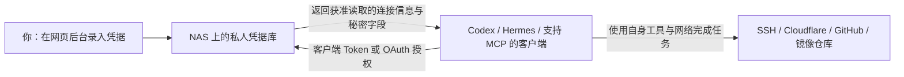

# 私人凭据库 · NAS MCP Console

把 SSH 账号密码、API 密钥和 Token 保存在自己的 NAS，通过 MCP 提供给获准访问的 AI 客户端。配置一次连接，之后在新对话中按需取用，省去反复粘贴凭据。

中文可视化管理 · 中文凭据名称 · Docker Compose 部署 · Bearer Token / OAuth 授权 · `amd64` / `arm64`

[开始部署](docs/deployment.md) · [录入凭据和获取 Token](docs/credentials.md) · [接入客户端](docs/clients.md) · [常见问题](docs/troubleshooting.md) · [开发与维护](docs/development.md)

## 这个项目能做什么

- 在网页后台新增、编辑、删除凭据；支持中文名称，例如 `家里NAS`、`工作GitHub`。
- 保存 SSH 密码或私钥、Cloudflare API Token / Global API Key、Alist 账号密码、GitHub Token、Docker Hub / GHCR Token。
- 在配置时测试认证是否可用，SSH 首次连接支持确认主机指纹。
- 给不同客户端单独授权全部凭据或指定条目，支持撤销。
- 提供手动客户端 Token，以及内置 OAuth 登录、凭据范围选择和同意授权。
- 将凭据加密保存在持久化目录中，容器更新后继续使用。

**MCP 负责提供凭据，具体任务由调用它的客户端执行。** 例如，Hermes 获取 SSH 信息后在自己的运行环境登录服务器；Codex 获取 GitHub Token 后使用本机工具操作仓库。凭据库本身不提供 SSH 执行、DNS 修改、建仓或推送镜像工具。



接入凭据库不会自动给客户端增加终端、SSH 或 Docker 能力；这些能力和目标网络的可达性由客户端环境决定。返回的秘密值会进入调用客户端的工具上下文，客户端之后的处理和保存由该客户端控制。

## 文档导航

| 我想做什么 | 看这里 |
| --- | --- |
| 在飞牛或其他 NAS 上部署，调整端口和 `./data` | [部署指南](docs/deployment.md) |
| 配置 Lucky / HTTPS、理解“允许的 Host” | [访问入口与反向代理](docs/deployment.md#access) |
| 录入 SSH、Cloudflare、Alist、GitHub、Docker 凭据 | [凭据配置指南](docs/credentials.md) |
| 给 Codex / Hermes 添加 MCP，让新对话继续用 | [客户端接入指南](docs/clients.md) |
| 从支持的 ChatGPT 自定义 MCP 页面使用 OAuth 添加 | [客户端接入指南](docs/clients.md) |
| 更新 `latest`、备份、恢复或迁移旧卷 | [升级与备份](docs/deployment.md#maintenance) |
| 处理 401、421、看不到条目、测试失败 | [常见问题](docs/troubleshooting.md) |
| 本地运行、执行测试、维护镜像发布 | [开发与维护](docs/development.md) |

## 镜像与版本

当前发布版本为 **0.3.0**，提供 `linux/amd64`、`linux/arm64` 镜像。

| 镜像仓库 | 跟随最新发布 | 固定版本 |
| --- | --- | --- |
| [Docker Hub](https://hub.docker.com/r/jinshenganyuci/nas-mcp-console) | `docker.io/jinshenganyuci/nas-mcp-console:latest` | `docker.io/jinshenganyuci/nas-mcp-console:0.3.0` |
| [GHCR](https://github.com/jinshenganyuci/nas-mcp-console/pkgs/container/nas-mcp-console) | `ghcr.io/jinshenganyuci/nas-mcp-console:latest` | `ghcr.io/jinshenganyuci/nas-mcp-console:0.3.0` |

两处镜像均公开，拉取本项目镜像无需先配置 GitHub 或 Docker Hub 凭据。[发布记录](https://github.com/jinshenganyuci/nas-mcp-console/releases)

## 快速开始：飞牛 Docker Compose

1. 在飞牛 Docker 的 Compose 管理中创建项目，指定固定的项目目录。
2. 使用仓库里的 **[compose.fnos.yaml](compose.fnos.yaml)**，里面每一项都带中文说明。它直接拉取发布镜像，不需要下载源码或创建 `.env`。
3. 在 Compose 文件旁创建 `data` 目录，使所有者与文件中的 `user` 一致，目录权限为 `700`。默认使用 `1000:1000`；具体命令见[目录准备步骤](docs/deployment.md)。
4. 启动项目，打开 `http://NAS内网IP:8090/`。
5. 读取 `./data/first-login.txt` 中的临时密码，登录后设置自己的管理密码。修改成功后，临时密码文件会自动删除。

最常需要调整的是这三项，修改时保留 Compose 的其他配置：

```yaml
# 跟随最新版本时修改 image；希望固定版本则保留原来的 :0.3.0
image: docker.io/jinshenganyuci/nas-mcp-console:latest

# 左边是 NAS 访问端口，右边的容器端口保持 8090
ports:
  - "8090:8090"

# 数据保存在 Compose 文件旁的 data 目录
volumes:
  - ./data:/data
```

命令行启动方式，在已准备好目录权限的 Compose 项目目录执行：

```sh
docker compose -f compose.fnos.yaml pull
docker compose -f compose.fnos.yaml up -d
docker compose -f compose.fnos.yaml ps
```

`latest` 不会自行更新正在运行的容器；更新时仍需重新拉取并创建容器。完整说明见[部署指南](docs/deployment.md)。

## 第一次使用

1. **录入凭据。** 在后台添加条目，例如类型选 SSH，名称填 `家里NAS`，再填写主机地址、用户名 `root` 和密码。名称是用于查找的标签，与登录用户名不同。
2. **测试凭据。** 点击后台的测试功能，确认地址和认证信息填写正确。测试成功表示该次认证可用，不代表所有业务操作都有权限。
3. **配置入口。** 内网先通过 NAS IP 使用；外网或网页登录授权按[HTTPS 指南](docs/deployment.md#access)设置域名和反向代理。
4. **授权客户端。** 在“客户端授权”中新建 `我的Codex` 或 `我的Hermes`，选择允许读取的条目，保存只显示一次的客户端 Token；也可用内置 OAuth 授权。
5. **接入并验证。** 按[客户端指南](docs/clients.md)保存连接，先测试列出条目，再开始使用。

之后可以对已接入的客户端说：

> 从私人凭据库查找“家里NAS”的 SSH 信息，登录后查看服务状态，不要显示密码。

> 使用凭据库里的 GitHub Token 查看我的仓库，不要回显 Token。

每台设备或每个独立客户端需要配置一次连接。新对话能否调用，还取决于该客户端是否启用了此 MCP；这与聊天记录记忆是两回事。

## MCP 接口

服务地址为 `https://vault.example.com/mcp`，使用 **Streamable HTTP**。在真实配置中替换为自己的地址。

| 工具 | 参数 | 返回内容 |
| --- | --- | --- |
| `list_credentials` | `query` 可选，按名称、备注、连接信息等搜索 | 该客户端获准读取的条目、连接信息和 `available_fields`，不返回秘密值 |
| `get_credentials` | 必填 `credential_id`；可选 `fields` | 指定条目的连接信息，以及所选秘密字段；省略 `fields` 时返回该条目全部可用秘密字段 |

先查询，再使用返回的实际 ID 和字段名取用。以下是 MCP `tools/call` 的参数示例：

```json
{"name":"list_credentials","arguments":{"query":"家里NAS"}}
```

```json
{"name":"get_credentials","arguments":{"credential_id":"ssh/家里NAS","fields":["password"]}}
```

客户端可能给工具名加上服务器名称前缀。后台的凭据测试不作为 MCP 工具提供。

## 数据保存与使用边界

- **完整备份 `./data`。** 主密钥、加密凭据、管理设置、客户端授权和 OAuth 状态需要一起保存；具体步骤见[升级与备份](docs/deployment.md#maintenance)。
- **授权可读取真实秘密。** 手动客户端 Token 和 OAuth 授权决定可见条目范围；上游 GitHub、Cloudflare 等平台 Token 的业务权限仍由对应平台决定。
- **后台不会回显已保存秘密。** 编辑时秘密字段留空表示保留原值；需要替换时输入新值。
- **当前为单管理员、单进程服务。** 不支持多个实例同时写同一个数据目录。
- **公网访问使用 HTTPS。** 内置 OAuth 需要正确的对外地址；仅 HTTP 的内网地址可用于本地 Token 接入测试。

仓库示例只使用演示地址和占位值。反馈问题时提供版本、脱敏后的错误和复现步骤即可，不要提交 `data`、客户端 Token 或真实账号密钥。
